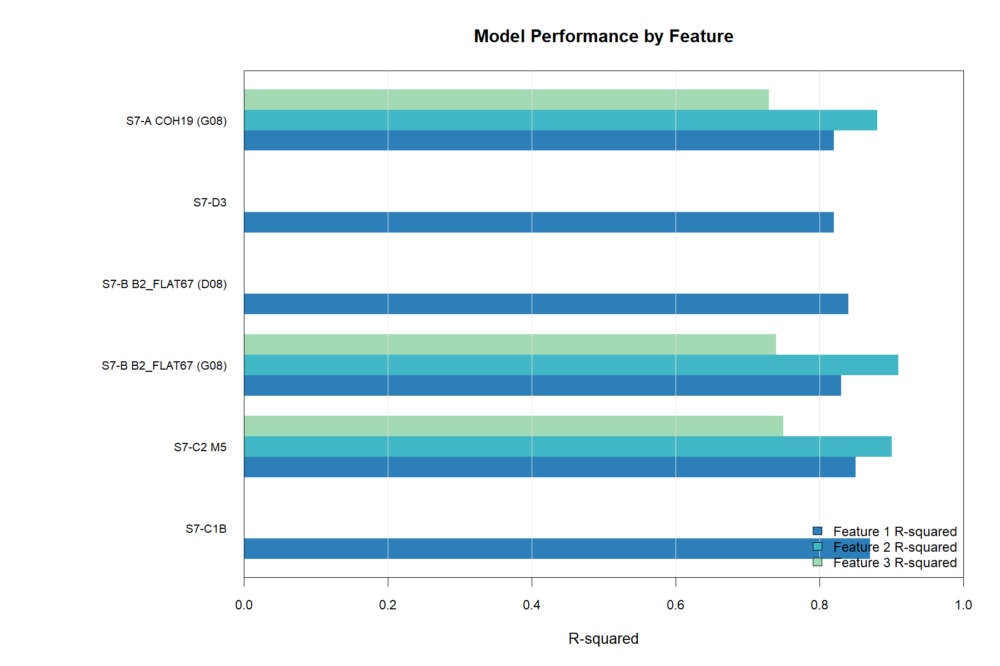

<!-- README.md is generated from README.Rmd. Please edit that file -->

```{r, include = FALSE}
knitr::opts_chunk$set(
  collapse = TRUE,
  comment = "#>"
)
```

# GEO712-repository-Yihao Xin

<!-- badges: start -->
<!-- badges: end -->

This repository contains my coursework for **GEO712**. It is set up as a reproducible R project: package versions are recorded with [{renv}](https://rstudio.github.io/renv/), and the repository is version-controlled with Git and hosted on GitHub.

# My Research Interest

My main research interest is **detecting and characterizing forest structure using multi-source Synthetic Aperture Radar (SAR) data**. I am particularly interested in integrating observations from *Sentinel-1 C-band, NISAR L-band, and BIOMASS P-band* to investigate how radar signals at different wavelengths respond to forest structural characteristics. Because these wavelengths interact with different parts of the forest canopy and woody components, combining them may provide complementary information for detecting and estimating forest structure. My research aims to explore the potential of multi-frequency SAR observations for more accurate and robust forest monitoring across different forest conditions.

# Favorites

## Favorite Music

1. Because - Crayon Case
2. 失去爱情的摩托车手 - THE BOOTLEGS
3. Graduation Song - Murphy Radio
4. Castles - Japanese Football
5. 漂流人间 - Chinese Football

## Favorite Equation

My favorite equation is the **Fourier transform**:

$$
F(\omega) = \int_{-\infty}^{\infty} f(t)e^{-i\omega t}\,dt
$$

## Favorite Artists

| Name | Achievements |
|:---|:---|
| Johannes Vermeer | *Girl with a Pearl Earring* |
| Edvard Munch | *The Scream* |
| Frank Weston Benson | *Summer* |
| Claude Monet | *Woman with a Parasol* |
| Ilya Repin | *What Freedom!* |

# A Chunk of Code

The following R code reads this `.Rmd` file and renders it as a PDF when run interactively in RStudio.

```{r render-rmd-to-pdf, eval = FALSE}
rmd_file <- "Xin-Activity-1.Rmd"

if (interactive()) {
  rmarkdown::render(
    input = rmd_file,
    output_format = "pdf_document"
  )
}
```

# Project Assets

The project keeps files organized by purpose:

- `data/` contains the model-performance data table
  `model_performance.csv`.
- `R/` contains the R script used to generate the model-performance figure.
- `figures/` contains figures generated from the project data.
- `easter-egg/` contains supplementary outputs from an earlier exercise.
- `README.Rmd` is the source document for this README, while `README.md` is
  the knitted GitHub document.
- `renv.lock` records the package versions needed to reproduce the project.

The following model-performance table is read from the project data folder
with `{here}`, so the file path remains stable when the project is opened from
another working directory.

```{r research-interest-data}
model_performance <- read.csv(
  here::here("data", "model_performance.csv"),
  stringsAsFactors = FALSE
)

knitr::kable(model_performance)
```

The figure below compares the available R-squared values for each model and
feature. Blank values indicate that a feature was not reported for that model.


