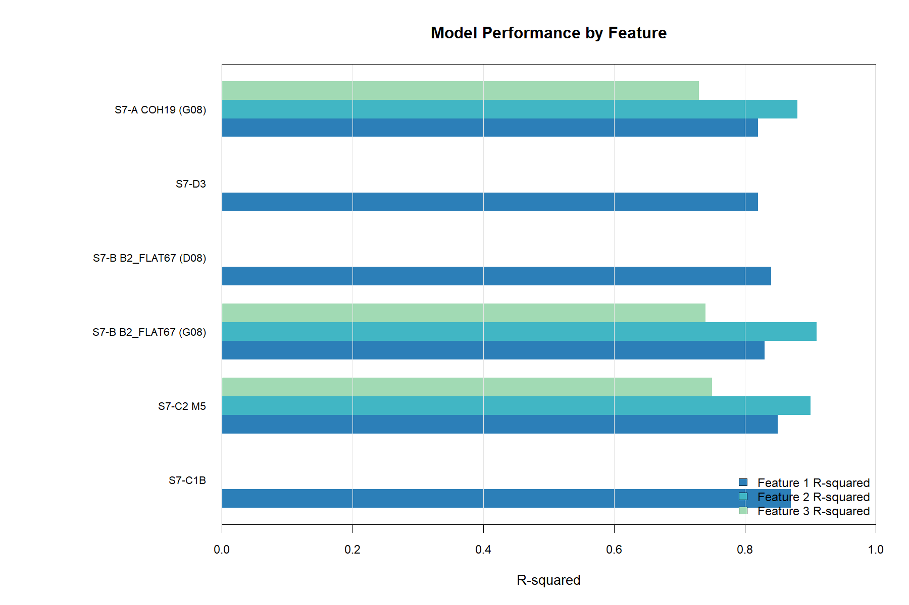

<!-- README.md is generated from README.Rmd. Please edit that file -->

```{r, include = FALSE}
knitr::opts_chunk$set(
  collapse = TRUE,
  comment = "#>"
)
```

# GEO712-repository-Yihao Xin

<!-- badges: start -->
<!-- badges: end -->

This repository contains my coursework for **GEO712**. It is set up as a reproducible R project: package versions are recorded with [{renv}](https://rstudio.github.io/renv/), and the repository is version-controlled with Git and hosted on GitHub.

# My Research Interest

My main research interest is **detecting and characterizing forest structure using multi-source Synthetic Aperture Radar (SAR) data**. I am particularly interested in integrating observations from *Sentinel-1 C-band, NISAR L-band, and BIOMASS P-band* to investigate how radar signals at different wavelengths respond to forest structural characteristics. Because these wavelengths interact with different parts of the forest canopy and woody components, combining them may provide complementary information for detecting and estimating forest structure. My research aims to explore the potential of multi-frequency SAR observations for more accurate and robust forest monitoring across different forest conditions.

# Activity: Project Data Analysis

This activity describes the two data sources planned for my forest-structure
project. The data-management questions follow the WHO, WHAT, WHEN, WHERE,
WHY, and HOW framework.

## Data expected to be used

### 1. NEON HARV 2025 forest data

I am using a selected 2025 subset from the National Ecological Observatory
Network (NEON) Harvard Forest site (HARV, site code D01). The local package
contains:

- 1-m canopy-height-model (CHM) GeoTIFF tiles;
- classified and colorized airborne LiDAR point-cloud tiles in LAZ format;
- RGB orthophoto tiles;
- 2025 vegetation field-inventory tables in CSV format, including
  apparent-individual and per-plot/per-year records; and
- NEON metadata, file inventories, checksums, and quality-assurance reports.

These are existing observational data collected by NEON and downloaded for
this project. I will create derived data by matching field plots to raster and
point-cloud tiles, calculating forest-structure metrics (for example height
percentiles, canopy cover, and plot-level summaries), and recording quality
checks and analysis-ready tables.

### 2. Hyytiälä UAV point-cloud demonstration dataset

The second source is the public *Hyytiälä UAV Point Cloud Demo Dataset -
2025*, a clipped subset of a larger forest survey in Hyytiälä, Finland
(SMEARII). The supplied `source_metadata.json` identifies the Zenodo record
as DOI [10.5281/zenodo.20793895](https://doi.org/10.5281/zenodo.20793895).
The dataset contains one LAS 1.2 point-cloud file (`cloud7_clip.las`) with
RGB values, metre units, coordinate reference system EPSG:32635 (WGS 84 /
UTM zone 35N), and coordinate scale factors of 0.0001 m. The source
metadata states that the point cloud was produced through a DJI L2 workflow
processed with DJI Terra 4.5.18.1 and exported using CloudCompare.

This is an existing public dataset, not data collected by me. I will create
derived summaries or visualizations from it, while preserving the original
file and its metadata. The source record explicitly describes the release
as a demonstration sample and says that no formal quality assessment was
performed; therefore, I will not treat it as validated ground truth without
additional checks.

## Information about the data

### Who?

- **NEON HARV:** NEON collected and processed the observatory data. The
  downloaded package was selected, organized, and documented for this
  project by me. NEON is the source to contact for product definitions,
  collection procedures, and official metadata.
- **Hyytiälä UAV:** The Zenodo metadata lists Jon Atherton and Iiro Erik
  Miettinen as creators and lists Miettinen as a data collector affiliated
  with the University of Helsinki. The dataset owner and source contact are
  identified by the Zenodo record. I am only creating project-specific
  derived products.

### What?

The data describe forest structure from complementary sources: field
observations provide plot-level vegetation information; LiDAR and UAV point
clouds provide three-dimensional observations of vegetation; CHM and RGB
orthophotos provide gridded height and image information.

The measured or supplied parameters include tree or vegetation observations,
plot identifiers, coordinates and dates in the field tables; point
locations,
classification and RGB attributes in point clouds; canopy height in CHM
rasters; and spectral/image information in orthophotos. The exact variable
definitions will be taken from the product metadata rather than inferred
from column names alone.

The main formats are CSV, LAZ, LAS, GeoTIFF, GeoJSON, JSON, XML, HTML, and
PDF. CSV, LAZ/LAS, GeoTIFF, GeoJSON, and JSON are open or widely documented
formats, although specialized software may be needed for efficient point-
cloud processing. PDF and HTML reports will be retained as documentation and
converted to plain-text notes only when useful.

Data quality is mixed. NEON products include product metadata and QA/QC
reports that I will consult before analysis. The Hyytiälä release is
explicitly provided "as is" with no formal public quality assessment, so I
will check coordinate reference systems, bounds, missing values, point
densities, classifications, and plausible height ranges before using it.

The appropriate uses are exploratory forest-structure analysis, method
development, visualization, and reproducible coursework. The data should
not be used to make unsupported operational, engineering, commercial, or
management decisions, especially where the source quality statement does
not justify that use.

### When?

The analysis uses observations collected or released for 2025. The HARV
package includes 2025 field-inventory records and corresponding remote-
sensing products selected from the downloaded archive. The Hyytiälä source
record describes a 2025 survey and was published as a 2025 demonstration
dataset record. Processing dates, source release dates, software versions,
and any date transformations will be recorded in the project metadata.

### Where?

The NEON observations are from the HARV site in the NEON D01 domain,
Harvard Forest. The Hyytiälä observations are from SMEARII in Finland. The
HARV tiles and field plots will be joined only after checking their declared
coordinate reference system and spatial extent. The Hyytiälä point cloud
uses EPSG:32635. The raw source files are kept outside the Git repository
on the local data drive; this repository stores documentation, small
analysis tables, scripts, and reproducible references rather than the
multi-gigabyte raw archive.

### Why and how?

These data were collected to support ecological and environmental
monitoring. I will use them to compare field observations with remotely
sensed forest structure and to test reproducible workflows for extracting
forest metrics from multiple sensors. The workflow will:

1. preserve the original files and checksums;
2. read and record source metadata before processing;
3. verify CRS, spatial extent, acquisition date, units, missingness, and
   file integrity;
4. link field plots to the appropriate CHM, LiDAR, orthophoto, or UAV data;
5. generate clearly named derived tables and figures; and
6. record software versions, parameters, warnings, and validation results.

Access is available to me through the local downloaded copies. Future users
should obtain NEON data from the official NEON distribution and the
Hyytiälä sample from its Zenodo record so that they receive the proper
license, citation, and version information.

## Legal and ethical restrictions

The data are environmental observations and are not expected to contain
personal or sensitive human-subject information. Nevertheless, I will
respect the source terms, cite NEON and the Zenodo record, preserve
attribution, and avoid redistributing the raw archives without checking
their source licenses and distribution conditions. The Hyytiälä metadata
specifies a CC BY 4.0 license, so reuse requires attribution and
identification of changes. I will not publish sensitive exact locations if
future field data introduce conservation, landowner, or access concerns.

## Data-management strategies

I will protect the value of the data by keeping raw files immutable,
preserving checksums, retaining source metadata and QA/QC reports, and
separating raw, intermediate, and derived data. I will use version control
for scripts and documentation, a changelog for processing decisions, and
small validation tables for reproducibility. Raw data will remain on the
local data drive in a structured directory and will be backed up to a
second storage location. The GitHub repository will contain code,
documentation, metadata summaries, and small derived examples, not the
multi-gigabyte LiDAR and imagery files.

## File naming convention

I will use lowercase, descriptive, machine-readable names with underscores
and ISO dates:

```text
<source>_<site>_<product>_<date-or-year>_<spatial-id>_<processing-level>.<ext>
```

Examples:

```text
neon_harv_chm_2025_tile-731000-4712000_raw.tif
neon_harv_lidar_2025_tile-731000-4712000_raw.laz
neon_harv_fieldinventory_2025_plot-summary_derived.csv
hyytiala_uav_pointcloud_2025_clip7_raw.las
hyytiala_uav_pointcloud_2025_clip7_qc-summary_derived.csv
```

The preferred project identifier for Hyytiälä is `hyytiala`. Original source
filenames will be preserved in a manifest, while renamed working copies will
follow the convention above. Version, date, CRS, and processing status will
be recorded in companion metadata rather than encoded in ambiguous
abbreviations.

## Standards and documentation

Relevant standards and best practices include NEON product definitions and
QA/QC reports; EPSG coordinate reference system identifiers; LAS/LAZ point-
cloud conventions; GeoTIFF geospatial metadata; CSV and UTF-8 text
interchange; ISO 8601 dates; checksums such as SHA-256; and FAIR principles
(findable, accessible, interoperable, and reusable). I will create a
project data dictionary, a source-to-derived lineage table, a README for
each processing stage, and a validation checklist covering CRS, units,
extent, missingness, duplicates, and plausible ranges.

For each derived product I will document the source filename and version,
processing date, software and package versions, commands or scripts,
parameters, coordinate system, units, exclusions, warnings, and quality
checks. A final manifest will link every published figure or table back to
the raw source and the exact code used to create it.

# Favorites

## Favorite Music

1. Because - Crayon Case
2. 失去爱情的摩托车手 - THE BOOTLEGS
3. Graduation Song - Murphy Radio
4. Castles - Japanese Football
5. 漂流人间 - Chinese Football

## Favorite Equation

My favorite equation is the **Fourier transform**:

$$
F(\omega) = \int_{-\infty}^{\infty} f(t)e^{-i\omega t}\,dt
$$

## Favorite Artists

| Name | Achievements |
|:---|:---|
| Johannes Vermeer | *Girl with a Pearl Earring* |
| Edvard Munch | *The Scream* |
| Frank Weston Benson | *Summer* |
| Claude Monet | *Woman with a Parasol* |
| Ilya Repin | *What Freedom!* |

# A Chunk of Code

The following R code reads this `.Rmd` file and renders it as a PDF when run interactively in RStudio.

```{r render-rmd-to-pdf, eval = FALSE}
rmd_file <- "Xin-Activity-1.Rmd"

if (interactive()) {
  rmarkdown::render(
    input = rmd_file,
    output_format = "pdf_document"
  )
}
```

# Project Assets

The project keeps files organized by purpose:

- `data/` contains the model-performance data table
  `model_performance.csv`.
- `R/` contains the R script used to generate the model-performance figure.
- `figures/` contains figures generated from the project data.
- `easter-egg/` contains supplementary outputs from an earlier exercise.
- `README.Rmd` is the source document for this README, while `README.md` is
  the knitted GitHub document.
- `renv.lock` records the package versions needed to reproduce the project.

The following model-performance table is read from the project data folder
with `{here}`, so the file path remains stable when the project is opened from
another working directory.

```{r research-interest-data}
model_performance <- read.csv(
  here::here("data", "model_performance.csv"),
  stringsAsFactors = FALSE
)

knitr::kable(model_performance)
```

The figure below compares the available R-squared values for each model and
feature. Blank values indicate that a feature was not reported for that model.


