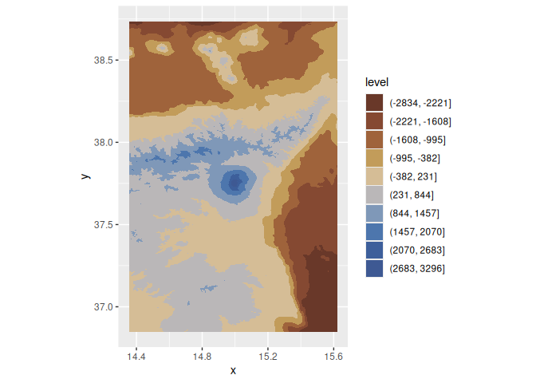
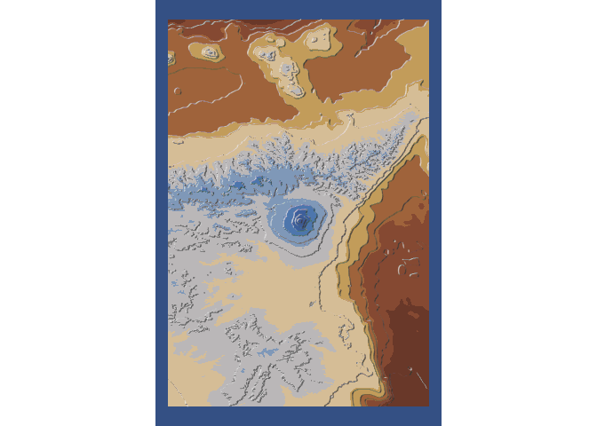

Generate contours for Mount
[Etna](https://en.wikipedia.org/wiki/Mount_Etna) using the technique of
[Tanaka](http://wiki.gis.com/wiki/index.php/Tanaka_contours).

We will use the following packages:

``` r
library(elevatr) # To get elevation data
library(MexBrewer) # Color palettes
library(metR) # For contouring 
library(terra) # To work with rasters
library(tidyverse) # Data carpentry and ggplot2
```

## Retrieve elevation data and process

Use {elevatr} to get elevation data:

``` r
etna <- get_elev_raster(locations = data.frame(x = c(14.3534, 15.6234), 
                                               y = c(36.8466, 38.736)),
                        z = 10, 
                        prj = "EPSG:4326",
                        clip = "locations")
```

    ## Mosaicing & Projecting

    ## Clipping DEM to locations

    ## Note: Elevation units are in meters.

Convert to {terra} `SpatRaster` object and thereof to data frame:

``` r
etna <- rast(etna)

etna <- as.data.frame(etna, 
                      xy = TRUE) %>%
  rename(elev = 3)
```

Plot contours; use a palette from
[{MexBrewer}](https://github.com/paezha/MexBrewer):

``` r
cols <- mex.brewer("Alacena", n = 11)

ggplot(data = etna,
       aes(x, y, z = elev)) +
  geom_contour_filled(breaks = seq(min(etna$elev), 
                                   max(etna$elev), 
                                   length.out = 11)) +
  #geom_contour_tanaka() + 
  scale_fill_manual(values = cols) +
  coord_equal()
```

<!-- -->

Repeat plot but now with Tanaka countours:

``` r
ggplot(data = etna,
       aes(x, y, z = elev)) +
  geom_contour_filled(breaks = seq(min(etna$elev), 
                                   max(etna$elev), 
                                   length.out = 11)) +
  geom_contour_tanaka(sun.angle = 60, 
                      smooth = 10) + 
  scale_fill_manual(values = cols) +
  coord_equal() +
  theme_void() + 
  theme(legend.position = "none",
        plot.background = element_rect(color = NA,
                                       fill = cols[11]))
```

<!-- -->

``` r
ggsave("etna-tanaka-contours.png",
       #width = 8,
       height = 12,
       units = "in")
```

    ## Saving 7 x 12 in image
